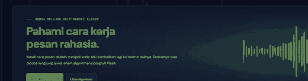

# CipherLab — Studio Sandi Klasik

**CipherLab** adalah media pembelajaran berbasis web untuk memahami cara kerja enam algoritma kriptografi klasik. Pengguna dapat mencoba enkripsi dan dekripsi, memasukkan pesan serta kunci sendiri, dan mempelajari rumus beserta contoh perhitungannya secara langsung.

Proyek ini dibuat sebagai bagian dari **Tugas Ujian Tengah Semester (UTS) Cyber Security**.

<p align="center">
  <a href="https://krisna-wibowo-06024010.netlify.app/">
    <strong>BUKA APLIKASI CIPHERLAB ↗</strong>
  </a>
</p>

---

## Pratinjau Aplikasi

<p align="center">
  
</p>

<p align="center">
  <em>Tampilan dasbor CipherLab.</em>
</p>

> Catatan: berkas pratinjau saat ini berupa satu frame (gambar statis) dalam format GIF, bukan rekaman animasi beberapa frame.

## Tentang Proyek

Kriptografi merupakan metode untuk mengubah pesan menjadi bentuk lain agar isinya tidak langsung dapat dibaca oleh pihak yang tidak memiliki cara untuk mengembalikannya.

CipherLab memperkenalkan enam algoritma kriptografi klasik dalam bentuk aplikasi web interaktif. Pengguna dapat memasukkan pesan, menentukan kunci, menjalankan proses enkripsi atau dekripsi, kemudian mempelajari cara kerja algoritma yang dipilih.

Aplikasi berjalan langsung di browser tanpa backend maupun database. Riwayat proses disimpan secara lokal menggunakan **LocalStorage** pada browser dan perangkat yang digunakan.

## Identitas Penyusun

| Keterangan | Identitas |
|---|---|
| Nama | Krisna Wibowo |
| NIM | 06024010 |
| Program Studi | Teknik Informatika |
| Universitas | Tanri Abeng University |
| Tugas | Ujian Tengah Semester Cyber Security |

## Fitur Aplikasi

- Enkripsi dan dekripsi menggunakan enam algoritma kriptografi klasik.
- Laboratorium interaktif untuk mencoba algoritma dengan pesan dan kunci sendiri.
- Penjelasan rumus, arti simbol, dan contoh perhitungan setiap algoritma.
- Riwayat proses enkripsi dan dekripsi yang tersimpan di LocalStorage.
- Fitur menyalin hasil proses.
- Pengaturan untuk mempertahankan huruf besar dan kecil.
- Pilihan tema gelap dan terang.
- Intro sinematik bertema cyber security dengan tombol untuk melewatinya.
- Animasi karakter digital bergaya Matrix.
- Visualisasi gelombang hijau seperti equalizer pada dasbor.
- Tampilan responsif untuk desktop dan perangkat seluler.

## Algoritma yang Digunakan

CipherLab menyediakan enam algoritma yang terbagi menjadi dua kelompok: **substitusi** dan **transposisi**. Untuk algoritma substitusi, huruf alfabet dipetakan menggunakan nilai A = 0 sampai Z = 25.

### 1. Caesar Cipher

Caesar Cipher mengganti setiap huruf dengan huruf lain berdasarkan jumlah pergeseran tertentu.

**Rumus:**

```text
Enkripsi : C = (P + k) mod 26
Dekripsi : P = (C - k) mod 26
```

Keterangan:
- P = nilai huruf pada pesan asli.
- C = nilai huruf hasil enkripsi.
- k = jumlah pergeseran.
- mod 26 = sisa pembagian dengan 26.

**Contoh:** huruf H dienkripsi menggunakan kunci 3.

```text
H = 7

C = (P + k) mod 26
C = (7 + 3) mod 26
C = 10
10 = K
```

Dengan kunci 3, pesan `HELLO` menjadi `KHOOR`.

### 2. Vigenère Cipher

Vigenère Cipher menggunakan kata kunci yang diulang mengikuti panjang pesan. Setiap huruf mendapat pergeseran berdasarkan huruf kunci pada posisi yang sama.

**Rumus:**

```text
Enkripsi : Cᵢ = (Pᵢ + Kᵢ) mod 26
Dekripsi : Pᵢ = (Cᵢ - Kᵢ) mod 26
```

**Contoh:**

```text
Pesan : HELLO
Kunci : KEY
```

Kunci diulang hingga mengikuti panjang pesan:

```text
Pesan : H E L L O
Kunci : K E Y K E
```

Perhitungan beberapa huruf:

```text
H = 7, K = 10
(7 + 10) mod 26 = 17 = R

E = 4, E = 4
(4 + 4) mod 26 = 8 = I

L = 11, Y = 24
(11 + 24) mod 26 = 9 = J
```

Hasil akhirnya adalah `RIJVS`.

### 3. Atbash Cipher

Atbash Cipher menggunakan urutan alfabet terbalik. Huruf A dipasangkan dengan Z, B dengan Y, C dengan X, dan seterusnya.

**Rumus:**

```text
Enkripsi dan dekripsi : C = 25 - P
```

**Contoh:**

```text
H = 7

C = 25 - 7
C = 18
18 = S
```

Pesan `HELLO` menjadi `SVOOL`.

Atbash tidak membutuhkan kunci. Proses enkripsi dan dekripsinya menggunakan cara yang sama.

### 4. Affine Cipher

Affine Cipher menggunakan operasi perkalian dan penjumlahan untuk mengubah nilai huruf. Algoritma ini memiliki dua kunci, yaitu a dan b.

**Rumus:**

```text
Enkripsi : C = (a × P + b) mod 26
Dekripsi : P = a⁻¹ × (C - b) mod 26
```

**Contoh:** gunakan a = 5, b = 8, dan H = 7.

```text
C = (a × P + b) mod 26
C = (5 × 7 + 8) mod 26
C = 43 mod 26
C = 17
17 = R
```

Untuk dekripsi, invers 5 modulo 26 adalah 21 karena:

```text
(5 × 21) mod 26 = 1
```

Kemudian:

```text
P = 21 × (17 - 8) mod 26
P = 189 mod 26
P = 7
7 = H
```

Nilai a harus relatif prima terhadap 26 agar invers modulo dapat ditemukan.

### 5. Rail Fence Cipher

Rail Fence Cipher merupakan algoritma transposisi. Huruf tidak diganti, tetapi posisinya disusun membentuk pola zigzag berdasarkan jumlah baris atau rail.

**Contoh:**

```text
Pesan : WEAREDISCOVERED
Rail  : 3
```

Susunan zigzag:

```text
W   E   C   R
 E R D S O E E
  A   I   V   D
```

Kemudian baca setiap baris:

```text
Baris 1 : WECR
Baris 2 : ERDSOEE
Baris 3 : AIVD
```

Hasil enkripsi: `WECRERDSOEEAIVD`.

### 6. Columnar Transposition

Columnar Transposition menyusun pesan ke dalam tabel berdasarkan panjang kata kunci. Kolom dibaca mengikuti urutan alfabetis huruf pada kata kunci.

**Contoh:**

```text
Pesan : WEAREDISCOVERED
Kunci : ZEBRA
```

Tabel penyusunan:

```text
Z E B R A
W E A R E
D I S C O
V E R E D
```

Urutan alfabetis kunci:

```text
A = kolom 5
B = kolom 3
E = kolom 2
R = kolom 4
Z = kolom 1
```

Baca kolom sesuai urutan tersebut:

```text
Kolom A : EOD
Kolom B : ASR
Kolom E : EIE
Kolom R : RCE
Kolom Z : WDV
```

Hasil enkripsi: `EODASREIERCEWDV`.

## Teknologi yang Digunakan

| Teknologi | Kegunaan |
|---|---|
| HTML5 | Membuat struktur halaman aplikasi |
| CSS3 | Mengatur tampilan, tata letak, tema, dan animasi |
| JavaScript | Menjalankan proses enkripsi, dekripsi, dan interaksi |
| JavaScript Class (OOP) | Mengatur implementasi setiap algoritma |
| LocalStorage | Menyimpan riwayat proses pada browser |
| HTML Canvas | Membuat animasi karakter digital |

## Struktur Folder

```text
CipherLab-UTS/
├── index.html
├── README.md
├── assets/
│   ├── css/
│   │   └── style.css
│   ├── js/
│   │   ├── app.js
│   │   └── cipher.js
│   └── images/
│       └── cipherlab-preview.gif
└── tests/
    └── uji-algoritma.js
```

**Keterangan:**
- `index.html` berisi struktur utama aplikasi.
- `style.css` mengatur tampilan, tata letak, tema, dan animasi.
- `cipher.js` berisi implementasi enam algoritma menggunakan JavaScript Class.
- `app.js` mengatur navigasi, interaksi, proses enkripsi/dekripsi, dan riwayat.
- `uji-algoritma.js` digunakan untuk menguji hasil enkripsi dan dekripsi.
- `cipherlab-preview.gif` merupakan gambar pratinjau antarmuka untuk README.

## Cara Menjalankan

Aplikasi dapat dijalankan langsung melalui browser.

1. Clone repository:

   ```bash
   git clone https://github.com/Lortella/CipherLab-UTS.git
   ```

2. Buka folder proyek menggunakan Visual Studio Code.
3. Buka file `index.html` menggunakan ekstensi **Live Server**, atau buka file tersebut langsung melalui browser.
4. Aplikasi siap digunakan.

Tidak diperlukan PHP, Python, framework, maupun database untuk menjalankan aplikasi.

## Pengujian Algoritma

Pengujian dilakukan dengan membandingkan hasil enkripsi dengan hasil yang diharapkan, kemudian melakukan dekripsi untuk memastikan pesan kembali ke bentuk semula.

| Algoritma | Pesan | Kunci | Hasil Enkripsi |
|---|---|---|---|
| Caesar | HELLO | 3 | KHOOR |
| Vigenère | HELLO | KEY | RIJVS |
| Atbash | HELLO | Tanpa kunci | SVOOL |
| Affine | HELLO | a = 5, b = 8 | RCLLA |
| Rail Fence | WEAREDISCOVERED | 3 rail | WECRERDSOEEAIVD |
| Columnar Transposition | WEAREDISCOVERED | ZEBRA | EODASREIERCEWDV |

Untuk menjalankan pengujian, pastikan Node.js sudah terpasang, lalu jalankan perintah berikut dari direktori utama proyek:

```bash
node tests/uji-algoritma.js
```

## Catatan Penggunaan

- Algoritma substitusi memproses huruf A–Z. Spasi, angka, dan tanda baca tidak ikut diganti.
- Pengaturan huruf besar/kecil dapat dipilih melalui opsi **Pertahankan huruf besar/kecil**.
- Pada algoritma transposisi, karakter termasuk spasi dan tanda baca ikut berpindah posisi.
- Riwayat hanya tersimpan pada browser dan perangkat yang digunakan.
- Menghapus data situs pada browser dapat menghapus riwayat CipherLab.

## Batasan Keamanan

Algoritma kriptografi klasik dibuat untuk pembelajaran dan sudah tidak cukup aman untuk penggunaan modern. Jangan menggunakan CipherLab untuk melindungi password, data pribadi, transaksi, atau informasi rahasia.

---

<p align="center">
  Dibuat oleh <strong>Krisna Wibowo</strong><br>
  Tanri Abeng University · Teknik Informatika<br>
  <strong>Tugas UTS Cyber Security</strong>
</p>
